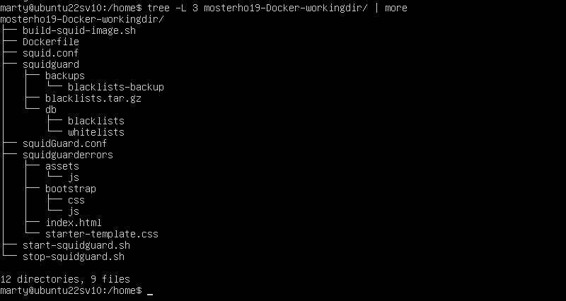

# Squid and Squidguard running in Docker on a Ubuntu server (version 22.04.5)
# I am very new to Docker, so this is very much a work in process
Note that my Docker profile is "mosterho19" and github is "mosterho". My Docker repository can be found [here:](https://hub.docker.com/repository/docker/mosterho19/squidguard/general). Source code can be found in [github:](https://github.com/mosterho/Docker-squidguard).
## Install Ubuntu server.
1. Install Ubuntu server. Mine is on VMware Workstation, 8Gb of memory with 1 processor/4 core and 100Gb of disk. 
        - Accept defaults during install, but check the box to install ssh-server (you may need to use this later).
2. sudo apt update
3. sudo apt full-upgrade
4. sudo apt install docker docker.io docker-buildx
	- optional installs: net-tools 
5. sudo dpkg-reconfigure tzdata
6. timedatectl (confirms the tzdata change)

## Pull Docker images
1. sudo docker pull mosterho19/squidguard
2. sudo docker pull httpd

## Setup Docker files
1. There are two files and two folders that need to be created on your docker server. I manually created the "/home/mosterho19-Docker-workingdir" folder on my system, but you can name it whatever you wish:
	- squid.conf -- there are over 9000 lines in the original squid.conf file; this file contains about 100 lines. All of the uncommented lines with some of the important comments were included. This contains the minimum required to get squidguard up and running. You may need to tweek this file to get your container up and running. Please see the github resource for this config file.
	- squidGuard.conf -- Currently setup to include all localnet IP addresses, a blacklist, and whitelist. The blacklists currenly include ads, adult, and malware. You will need to change the IP address of the redirect statement to match your IP (not sure if localhost will work). Please see the github resource for this config file.
		- NOTE: I have NOT yet created a working script to download the blacklists from this [Blacklist FTP Download site](ftp://ftp.ut-capitole.fr/pub/reseau/cache/squidguard_contrib/blacklists.tar.gz) just yet. Please see the following link for a web based download of blacklists.tar.gz ([same Blacklist website here](https://dsi.ut-capitole.fr/blacklists/download/)).
	- directory squidguard -- The blacklist files can be downloaded from the above link. To unzip, perform the following:
        - cd ./squidguard
		- sudo tar -xvzf blacklists.tar.gz
			- (tar flags: -x=extract  v=verbose (which you can leave out)  z=gzip format  f=archive name)
		- ** This does NOT create the db version of the files required by squidguard. This is one additional step I must figure out. Please see below and the "update_blacklist.sh" file in github for ideas.
	- directory squidguarderrors (used by the standalone httpd image) -- contains a couple folders and an index.html file. The html file is used for issuing a warning message when attempting to retrieve a blacklisted site. 
	- The three extra .sh files (build-squid-image, start-squidguard, and stop-squidguard) are for convenience only, and you can create your own version of them as needed.
2. Once you setup the above folders and files, it should look something like this:

3. Work-in-Process/Issues: 
	- I have not yet figured out how to download and rebuild the blacklists (and whitelist) in the "squidguard" folder. It works when I use Squidguard outside of Docker and just within a "regular" Ubuntu server. 
		- The only thing I can currently offer is to install an instance of squidguard on the same server and run the "update-blacklist.sh" in a terminal session, then copy or scp (SSH copy command) the resulting folders to "(yourfolder)/squidguard/db"
			- sudo scp -rsq yourusername@192.168.x.x/var/lib/squidguard .

## Starting Squidguard

1. Go to your working directory/folder (again, mine is "/home/mosterho19-Docker-workingdir"). Run the following:
	- sudo docker run -d -p 3128:3128 -v ./squid.conf:/etc/squid/squid.conf -v ./squidGuard.conf:/etc/squidguard/squidGuard.conf -v ./squidguard:/var/lib/squidguard   --name squidguard  mosterho19/squidguard
	- sudo docker run -d -p 8080:80 -v ./squidguarderrors:/usr/local/apache2/htdocs --name httpd httpd
	- sudo docker ps -a

# Next Steps for this Project
1. Learn how to bring github files into Docker file.
2. Blacklist download works for a server, but learn how to modify the Dockerfile to download and rebuild blacklists.
3. Install on Microsoft Azure.
